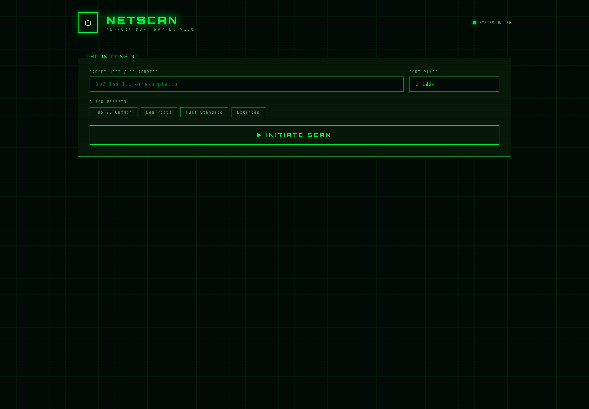
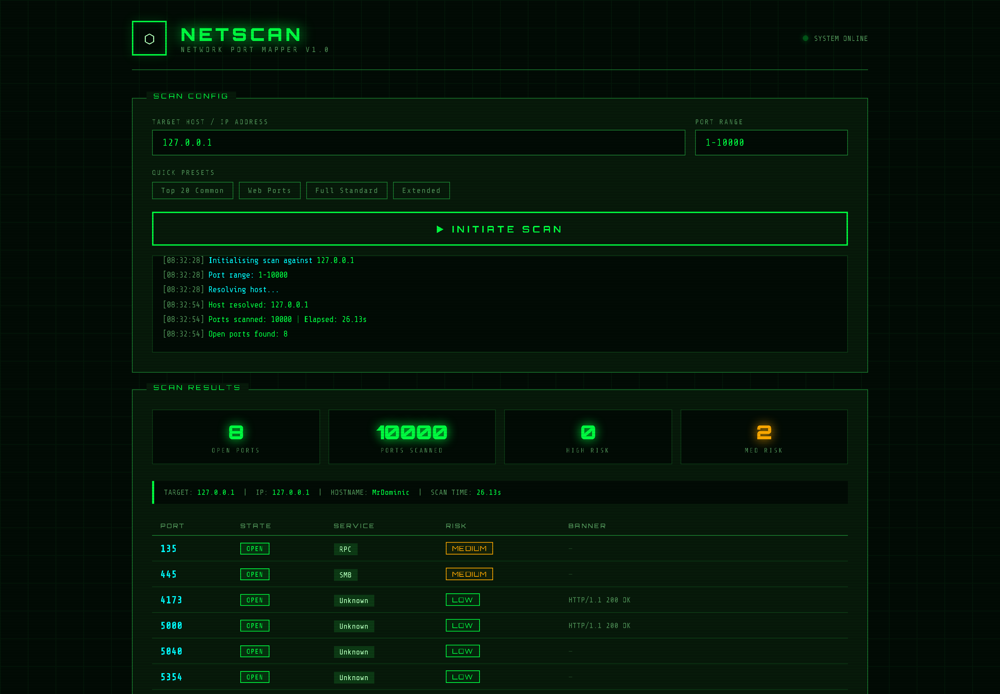

# NetScan — Port Mapper

**A TCP port scanner with a Flask backend and a terminal-themed web UI. Scans concurrent
hosts, identifies common services, grabs banners, and rates each exposed port by risk.**

<p>
  
  
  
</p>

> ⚠️ **Authorised testing only.** Scan hosts you own or have written permission to test.
> Port scanning systems you don't control is illegal in most jurisdictions, including under
> South Africa's Cybercrimes Act (2020). The presets make this easy to misuse — don't.

<table>
  <tr>
    <td width="50%" valign="top">
      <a href="docs/screenshots/home.png"></a><br>
      <sub><b>Start</b> — target, port range and the four presets.</sub>
    </td>
    <td width="50%" valign="top">
      <a href="docs/screenshots/scan-results.png"></a><br>
      <sub><b>Results</b> — a real scan of <code>127.0.0.1</code>, 1–10000: 8 open ports, 2 medium risk, 26 s.</sub>
    </td>
  </tr>
</table>

<sub>Scanned only loopback, on my own machine. That is the point of the warning above.</sub>

---

## Features

- **Concurrent TCP scanning** — a thread pool of 200 workers, so a 1–1024 sweep finishes in
  seconds rather than minutes
- **Service identification** — 20 common ports mapped to their services (SSH, HTTP, SMB,
  MySQL, RDP, Redis, MongoDB, Elasticsearch…)
- **Banner grabbing** — attempts to read the service banner to confirm what's actually
  listening, not just what's usually on that port
- **Risk rating** — each port classified LOW / MEDIUM / HIGH, with a summary count
  (Telnet, Redis, MongoDB, Elasticsearch and Memcached are flagged HIGH because they are
  the classic exposed-by-default offenders)
- **Quick presets** — Top 20 common, Web ports, Full standard (1–1024), Extended (1–10000)
- **Custom ranges** — `80,443,8080` or `1-65535`, capped at 10,000 ports per scan
- **Terminal UI** — scanline effect, glow, monospace. Unnecessary, but it makes the tool
  pleasant to look at while it works

## How it works

For each port the scanner calls `socket.connect_ex()` with a 0.5 s timeout. On a successful
connect it opens a second socket and sends `HEAD / HTTP/1.0` to try to elicit a banner —
which is why it identifies web servers well and SSH/SMTP less reliably. Results are
collected as futures complete rather than in order, then sorted by port before returning.

## Install and run

```bash
git clone https://github.com/dominicnkutha1-netize/netscan.git
cd netscan
pip install -r requirements.txt
python app.py
```

Open <http://localhost:5000>.

```bash
# your own machine
127.0.0.1

# a device on your own LAN
192.168.1.1

# a range
1-1024
```

## Project structure

```
netscan/
├── app.py                 # Flask app: scanning logic + two JSON endpoints
├── static/
│   └── index.html         # the whole UI — styles, layout and fetch calls
├── requirements.txt
└── README.md
```

`app.py` serves the UI out of `static/`, so `index.html` must live there. (It previously sat
at the repo root, which meant the app started and then served nothing — fixed.)

## API

| Method | Path | Purpose |
|---|---|---|
| `POST` | `/api/scan` | `{ "target": "127.0.0.1", "port_range": "1-1024" }` → open ports, services, banners, risk |
| `GET` | `/api/quick-presets` | The four preset port ranges |

Example response:

```json
{
  "target": "127.0.0.1",
  "ip": "127.0.0.1",
  "hostname": "localhost",
  "ports_scanned": 1024,
  "open_ports": [
    { "port": 22, "state": "open", "service": "SSH", "banner": null, "risk": "LOW" }
  ],
  "elapsed": 3.41,
  "risk_summary": { "HIGH": 0, "MEDIUM": 0, "LOW": 1 }
}
```

## Known limitations

- **The web UI has no authentication.** Anyone who can reach port 5000 can use it to scan
  your network. Keep it on `localhost`.
- **`debug=True` with `host="0.0.0.0"`** is the Flask dev server with the Werkzeug debugger
  enabled. Never expose that to a network — the debugger allows code execution. This is a
  local tool.
- **TCP only.** No UDP, no SYN/half-open scanning, no OS fingerprinting.
- **Banner grabbing is HTTP-biased** — it sends a `HEAD /` request regardless of port.
- **Fixed 0.5 s timeout** — hosts behind a firewall may silently drop rather than reject,
  making scans slower and results less certain.
- **No tests.**

## Roadmap

1. Bind to `127.0.0.1` by default and gate `debug` behind an environment variable.
2. Protocol-aware banner grabbing (SSH and SMTP send their banners unprompted).
3. Service-version detection rather than port-to-name mapping.
4. Export results as JSON or CSV.
5. Tests for the range parser — it's the part most likely to break on bad input.

## License

MIT
